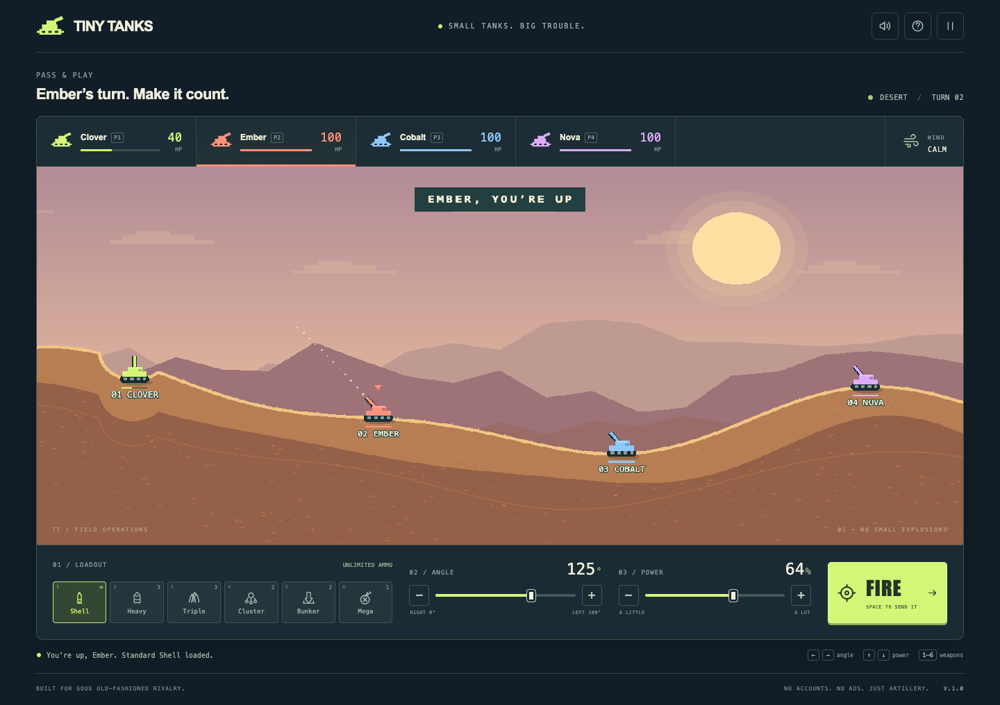

# Tiny Tanks — Arcade Edition

Small tanks. Big trouble. An original browser artillery game inspired by the genre’s DOS-era classics, built with strict TypeScript, Phaser 3, and Vite. All graphics and sounds are procedural; there are no external runtime services, accounts, ads, or backend.



[Main menu screenshot](docs/menu.png)

## Play

**2.1 — Fair & Fun AI:** distinct skill profiles, imperfect wind and target estimates, varied weapon choices, and limited learning from real shot outcomes. Normal is calibrated for competitive, fallible play; Hard is stronger without perfect aim. Quick Play stays on Normal. See [measured before/after results and parameters](docs/ai-calibration.md). `npm run calibrate` reproduces the real-physics scenario suite; `npm run calibrate:baseline` runs the frozen 2.0 comparison.

**Quick Play** starts one human against two Normal AI tanks, with a random theme, wind, and explosive crates. Custom solo and local games remain available. Aiming speed, the short trajectory preview, reduced motion, and sound are configurable. Holding touch controls and keyboard arrows uses the same smooth, accelerating input.

Arcade Edition adds layered explosions with smoke, sparks, dirt and debris; weapon-specific recoil, speeds and synthesized sounds; deeper bunker craters; decorative rocks; restrained high-shot camera following; and AI that weighs damage, ammunition, self-hit risk, and crate opportunities. Crate chains resolve in stable order, with a strict eight-crate safety bound. Up to three crates spawn clear of tanks when enabled.

- One human vs 1–3 computer tanks, with Easy, Normal, and Hard AI.
- 2–4 players sharing one device.
- Six weapons: Standard Shell, Heavy Shell, Triple Shot, Cluster Bomb, Bunker Buster, and Mega Bomb. Special weapons have limited ammunition; standard shells are unlimited.
- Destructible seeded hills, wind, direct hits, blast falloff, falling damage, health, match results, and instant rematches.
- Green Hills, Desert, and Moon themes. Moon has lower gravity.
- Keyboard, mouse, and touch controls; synthesized sound with mute and volume settings; offline PWA support.

Last tank standing wins. Local multiplayer advances directly to the next player; pass the device when their name appears. Match settings configure tank count, AI difficulty, wind, terrain, starting health, and crates. Sound, aiming and motion preferences apply immediately; combat settings changed while paused apply on restart.

## Controls

| Action        | Desktop             | Touch / mouse              |
| ------------- | ------------------- | -------------------------- |
| Aim           | Left / right arrows | Angle slider or hold − / + |
| Power         | Up / down arrows    | Power slider or hold − / + |
| Choose weapon | 1–6                 | Loadout buttons            |
| Fire          | Space               | FIRE                       |
| Pause         | Escape              | Pause button               |

Angles use physical coordinates: **0° right, 90° up, 180° left**. Wind’s arrow shows its direction; higher numbers bend shots more. Direct hits do extra damage. Removing ground beneath a tank can cause additional fall damage. Cluster bombs split during descent; bunker shells travel into the ground before exploding.

## Local records

The flag button opens your arcade record as **Clover / Player 1**, including local multiplayer. Completed matches contribute wins, losses, matches, damage, best accuracy, largest hit, and longest chain. Accuracy counts shots that damage at least one opponent, once per shot, including fall and crate damage; self hits never count. Damage is actual health removed, excluding overkill and self damage. Match duration counts active simulation time, excluding pauses.

Five local achievements: **First Victory**, **Sharpshooter** (75% accuracy over at least three shots), **Chain Reaction** (two crates in one chain), **Demolition Expert** (500 total damage), and **Comeback Victory** (win after surviving at 25% health). Chain Reaction unlocks immediately; match-based records and other achievements update at results. Storage is optional: the game still works when it is unavailable. Records remain on this browser/device.

Rematch retains the match rules and creates a fresh seed. **Replay this map** retains the seed too. Results show kills, damage, shots, accuracy, duration, and the longest chain.

## Develop and build

Use Node.js **22.12+** (Node 20.19+ also works) and npm.

```sh
npm ci
npm run dev
```

```sh
npm run typecheck
npm test
npm run build
npm run preview
```

`dist/` is the complete static production website. The Vite development server runs at `http://127.0.0.1:5173/`; preview defaults to port 4173. The service worker is enabled in production builds, not the development server.

### Browser verification

The Playwright suite covers local multiplayer, all six loadout selections, keyboard aiming, firing, pause/resume, a full human-vs-AI match, elimination and rematch, touch controls, orientation/resize, manifest/icon loading, offline reload and gameplay, records, comfort preferences, and one-click Quick Play.

```sh
npx playwright install chromium
npm run build
npm run test:browser
```

With locally installed Google Chrome, use `PLAYWRIGHT_CHROME=1 npm run test:browser` instead. Screenshots and failure traces go to the ignored `test-results/` directory.

To verify a project subdirectory:

```sh
VITE_BASE_PATH=/tiny-tanks/ npm run build
VITE_BASE_PATH=/tiny-tanks/ npm run preview -- --port 4173
```

In another terminal:

```sh
TEST_URL=http://127.0.0.1:4173/tiny-tanks/ PLAYWRIGHT_CHROME=1 npm run test:browser
```

Omit `PLAYWRIGHT_CHROME=1` when using Playwright’s downloaded Chromium. Use any desired repository name in place of `tiny-tanks`.

## GitHub Pages

The existing `.github/workflows/deploy.yml` runs rule tests, typechecks, builds, verifies production gameplay and offline support in Chromium, uploads **dist**, and deploys on pushes to `main` or manual workflow dispatch. Browser screenshots and failure traces are retained as a workflow artifact for seven days. It uses official GitHub actions, Node 22, the `github-pages` environment, and only `contents: read`, `pages: write`, and `id-token: write` permissions.

1. Push this project to your GitHub repository’s `main` branch.
2. Open **Repository → Settings → Pages → Build and deployment → Source** and select **GitHub Actions**. Repository administration permission is required.
3. Under **Settings → Actions → General**, ensure GitHub Actions and the official `actions/*` actions are allowed. If an organization restricts Pages, an administrator must allow Pages deployment.
4. Open **Actions → Test and deploy Tiny Tanks**. Run the workflow manually if the initial push happened before enabling Pages.
5. Wait for the `deploy` job to succeed. The job’s environment link is the published URL. If the environment requires reviewers, approve its pending deployment.

The build derives `/REPOSITORY/` from `GITHUB_REPOSITORY` when `GITHUB_ACTIONS` is set. A `USERNAME.github.io` repository uses `/`. Local development uses `/`. `VITE_BASE_PATH` explicitly overrides these defaults, including for a custom domain. Manifest URLs, icons, scripts, the service worker scope, and offline navigation use the same base. There are no client-side routes to configure.

## Install and play offline

Visit the production HTTPS website online once and let it finish loading. Chrome/Edge may offer **Install game** in the footer or an install icon in the address bar. On iPhone/iPad, use Safari’s **Share → Add to Home Screen → Open as Web App**. Browser support and labels vary.

The service worker caches the app shell, icons, CSS, JavaScript, and bundled Phaser. Once the worker is active, relaunching or reloading works offline. The game has no network-dependent features. If a new version arrives during a match, its worker waits; finish the match and close all game tabs/windows before reopening to apply the update. Matches are held in memory and do not survive a page reload. Sound and match preferences are saved locally when storage is available.

## Source map

- `src/game/config.ts`: centralized world, theme, balance, settings, and seeded randomness.
- `src/game/terrain.ts`: heightmap generation and crater deformation.
- `src/game/physics.ts`: analytical fixed-step integration, swept collisions, and damage falloff.
- `src/game/match.ts`: tanks, projectile behaviors, damage, ammunition, settling, turns, and results; independent of Phaser.
- `src/game/weapons.ts`: reusable weapon definitions and ammunition rules.
- `src/game/ai.ts`: candidate trajectories evaluated with the same physics and terrain collisions as player shots.
- `src/game/ai-config.ts`, `src/game/ai-memory.ts`: centralized skill profiles and bounded, match-scoped shot learning. `src/calibration/` and `scripts/calibrate-ai.ts` measure actual gameplay outcomes without duplicating projectile physics.
- `src/game/scene.ts`: Phaser rendering, interpolation, visual effects, keyboard aiming, and AI timing.
- `src/game/crates.ts`, `src/game/records.ts`: safe crate placement, local statistics, and achievement rules.
- `src/game/effects.ts`: bounded procedural flashes, smoke, sparks, dirt, and debris.
- `src/game/audio.ts`: original Web Audio synthesis, unlocked by user interaction.
- `src/ui/app.ts`, `src/styles/main.css`: responsive DOM menus, HUD, controls, settings, results, and install prompt.
- `src/tests/`: deterministic Vitest rule tests; `tests/`: Playwright browser scenarios.
- `public/`, `scripts/create-icons.py`: original icons and their standard-library-only PNG generator.

## Verification and limits

Rule tests exercise ballistics, wind, swept collision, seeded terrain, craters, blast and direct-hit damage, elimination, turn order, skipped players, winners/draws, ammunition, every weapon behavior, valid AI shots, and complete matches in every theme.

Terrain is a heightmap: it supports craters, but no caves or overhangs. Tanks settle vertically and take fall damage; there is no lateral movement or loose-soil simulation. Portrait mode keeps the entire battlefield visible with controls below; landscape gives tanks more screen space. The canvas adapts its display proportions to compact desktop and mobile layouts while keeping the same logical physics coordinates. AI uses a bounded trajectory search and can miss, particularly with wind and special weapons. Combat settings changed in a paused match apply to the next restart; aiming, motion, and sound preferences apply immediately.

Browser automation can verify an active service worker, cached offline gameplay, manifest metadata, and responsive touch interactions. It does not verify native OS installation, physical-device performance, or speaker output. Native installation and a physical-device listening/play session remain recommended release checks.

Arcade Edition verification includes the original 31 rule tests plus 17 focused crate, chain termination, statistics, achievement, balance, and Quick Play tests. Six production browser scenarios include the original flows and Quick Play/records. Native OS installation, physical-device performance, and speaker output remain untested; Chrome touch emulation and offline gameplay are covered by browser verification.

Release checks on November 14, 2026: **48 unit tests and six production browser scenarios passed**, as did strict TypeScript checking and the production build under `/tiny-tanks/`. A reproducible legal shot was also played in Chrome to verify a three-crate chain, nearby tank damage, smoke/debris, and the immediate Chain Reaction achievement. Portrait/landscape layouts and a real emulated touch hold were inspected in Chrome. No physical-device or native installation result is implied.
